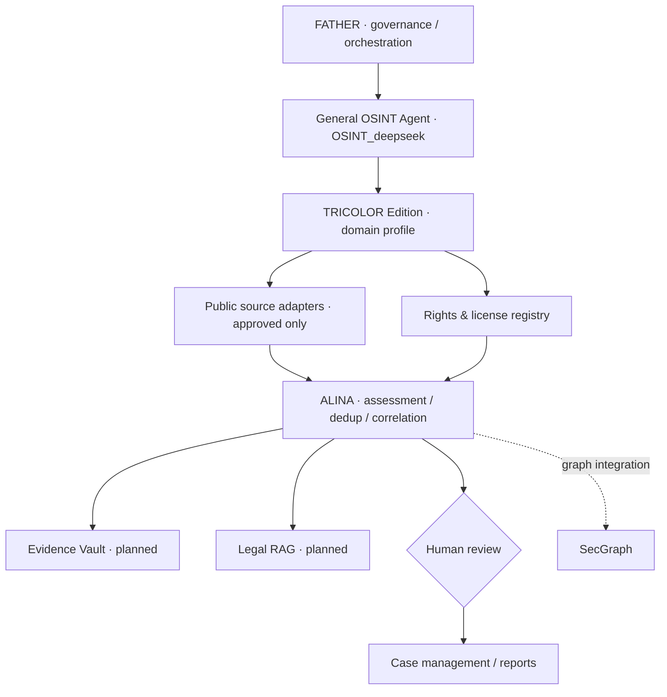

# FATHER OSINT · TRICOLOR Edition

> **Специализированный профиль основного OSINT-агента FATHER / OSINT_deepseek** для мониторинга внешних угроз, защиты медиаконтента, товарных знаков и анализа юридических кейсов.

  

**Репозиторий:** https://github.com/VictorKVS/OSINT_TRICOLOR  
**Локальный рабочий каталог пользователя:** `G:\1\OSINT_TRICOLOR`  
**Родительское OSINT-ядро:** [VictorKVS/OSINT_deepseek](https://github.com/VictorKVS/OSINT_deepseek)  
**Смежная система графового анализа:** [VictorKVS/SecGraph](https://github.com/VictorKVS/SecGraph)

> Независимая учебная и инженерная демонстрация. Проект не принадлежит НАО «Национальная спутниковая компания», не является официальным продуктом «Триколор» и не содержит подтверждённых обвинений в адрес третьих лиц.

## Архитектура



## Возможности MVP

- Приём находок из JSONL, нормализация URL и дедупликация.
- SQLite-реестр сигналов, журнал аудита, эвристическая очередь приоритетов.
- Markdown-отчёт **о гипотезах**, не о доказанных нарушениях.
- Отсутствие автономного сканирования сайтов, обхода ограничений и юридически значимых внешних действий.

## Запуск

```powershell
cd "G:\1\OSINT_TRICOLOR"
python .\agent.py init
python .\agent.py import .\sample_findings.jsonl
python .\agent.py report
python -m unittest discover -s tests -v
```

Для загрузки впервые на локальную машину: `git clone https://github.com/VictorKVS/OSINT_TRICOLOR.git "G:\1\OSINT_TRICOLOR"` (если папка уже занята, сначала проверь её содержимое).

## Навигация

| Артефакт | Назначение |
|---|---|
| [PROJECT_REPORT.md](PROJECT_REPORT.md) | Описание вакансии, предметной области и угроз |
| [AGENT_SPEC.md](AGENT_SPEC.md) | Техническое задание и границы MVP |
| [docs/ARCHITECTURE.md](docs/ARCHITECTURE.md) | Разделение общего ядра и отраслевого профиля |
| [docs/PROJECT_REGISTRY.md](docs/PROJECT_REGISTRY.md) | Реестровая карточка FATHER |
| [agent.py](agent.py) | CLI-движок MVP |
| [tests/](tests/) | Тесты |

## Безопасность и правовая корректность

Только законно доступные источники и разрешённые интеграции. Никакого обхода аутентификации, агрессивного сбора данных, деанонимизации физических лиц или автоматических претензий. Персональные данные минимизируются. Любое юридическое заключение требует эксперта.

## Roadmap

- **M0:** базовое офлайн-ядро и демонстрационные данные.
- **M1:** источник-ориентированные коннекторы и реестр прав/лицензий.
- **M2:** Evidence Vault, SHA-256, цепочка хранения и контроль доступа.
- **M3:** граф связей / SecGraph, Legal RAG и экспертная проверка.
- **M4:** FATHER dashboard, метрики качества, CI/CD, тесты и наблюдаемость.
