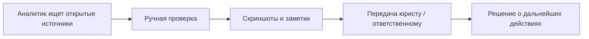
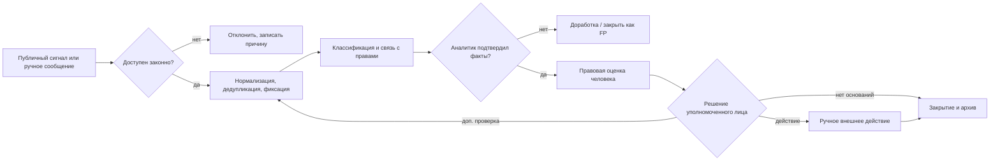

# B-001 Бизнес-процессы AS-IS / TO-BE (проектная гипотеза)
AS-IS ниже **не обследован у работодателя**, это только моделирование по тексту вакансии.

## AS-IS (гипотеза)

Проблемы, которые нужно проверить интервью: разрывы в истории кейса, повторения, непрозрачные критерии приоритета, ручной сбор и качество фиксации.

## TO-BE

## Карточка процесса
Вход: URL/документ + источник + разрешение на обработку. Владелец: аналитик. Выход: проверенный кейс или мотивированное закрытие. SLA: определить после обследования. Контроли: ограничения источников, права, ПД, audit, human approval.

## KPI
Precision подтверждённых сигналов; медиана времени от поступления до проверки; доля дублей; доля неполных доказательств; доля отмененных выводов; процент случаев с review; стоимость обработки одного кейса. Не задавать целевые значения до baseline.

## Требуемые BPMN дорожки
Источники / Сборщик / ALINA / OSINT-аналитик / Юрист / Руководитель / Архив. Для диаграмм нужны события начала и конца, gateway на доступность, права, доказательства и решение.
