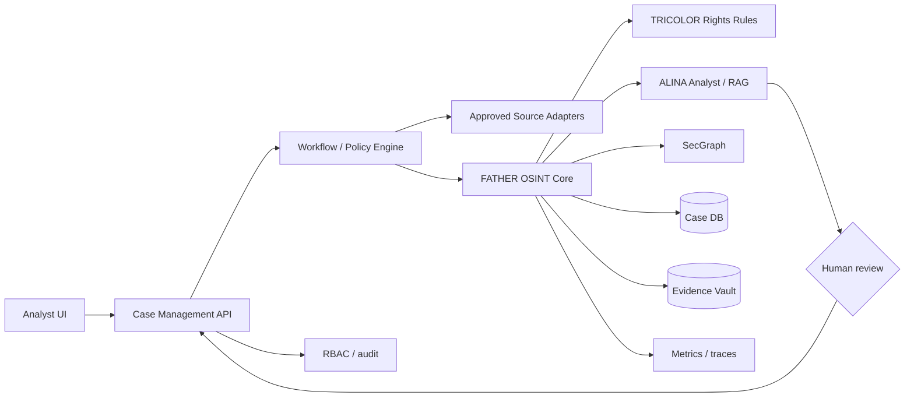

# D-001 Комплекс — проектная схема, не реализованная система

## Обязательные документы после G6
C4 context/container/component; BPMN L2; ERD; OpenAPI; data dictionary; DFD & trust boundaries; threat model; keys/secrets matrix; deployment on-prem/cloud; backup & DR with RPO/RTO; SLO; test strategy; release management; SBOM/license analysis; incident response; runbooks; access matrix.

## Initial entities
Source, CollectedArtifact, Finding, RightsObject, License, Organization, PublicAccount, Case, CaseEvent, ReviewDecision, Relationship, LegalReference, Export, AuditEvent. Все связи типизированы с provenance, confidence и review status.

## Integrations
OSINT_deepseek via versioned contracts; SecGraph via graph export/adapters; ALINA via controlled retrieval with citations; external sources only after allowlist and approved legal basis.
