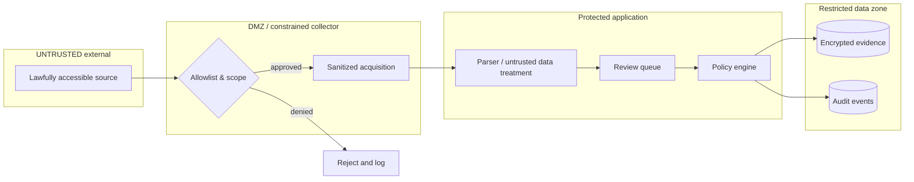

# SCH-03 · DFD-inspired Trust Boundaries

SECURITY: prohibit SSRF/private destinations, credential forwarding, prompt-injected commands; enforce outbound allowlist, data minimization, isolation, retention and audited human approval. This diagram is not a complete STRIDE threat model.
