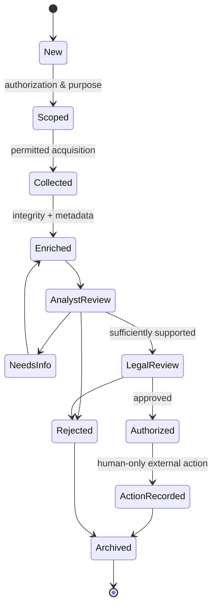

# SCH-04 · Case + Evidence state machine

Every transition records actor, timestamp, reason, evidence IDs, hash and provenance as applicable. Raw artifacts immutable; interpretation versioned and reviewable. No model-triggered irreversible action.
