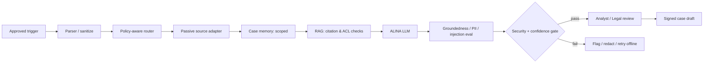

# SCH-05 · Visual agent workflow (logical)

No unrestricted tool execution by model. Separate untrusted content from instructions, capability-scoped tools, audit context, explicit provenance; enforce rights and non-attribution.
