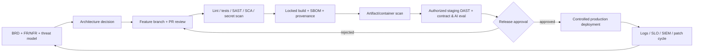

# SCH-06 · Secure software delivery

**Current state:** only a limited CI baseline is configured; remaining steps are target controls. Protect main / require PR review in GitHub settings before calling CI enforced. Never test third-party systems without permission.
