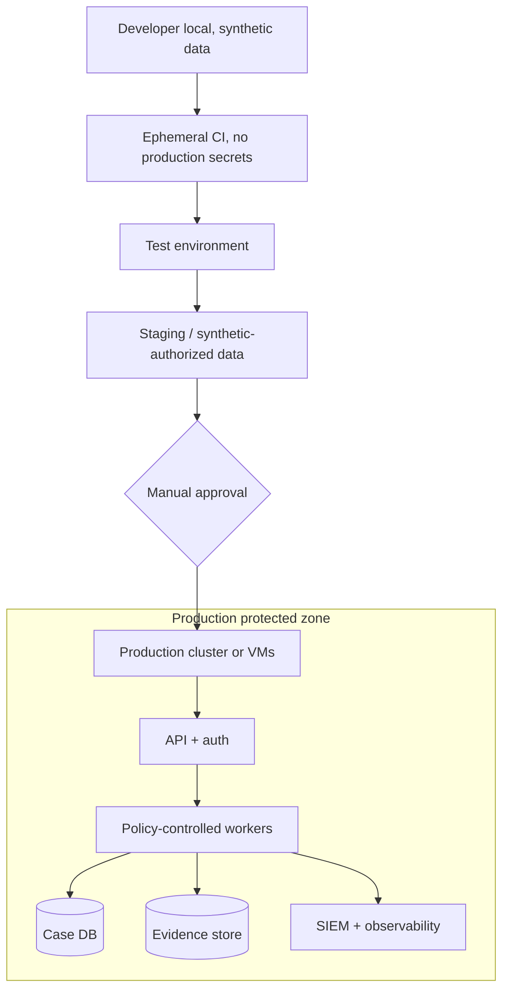

# SCH-07 · Environment isolation / deployment (candidate)

Platform choice VM vs containers vs Kubernetes after load sizing, TCO, RPO/RTO and risk analysis. Diagram does NOT mean Kubernetes was deployed.
