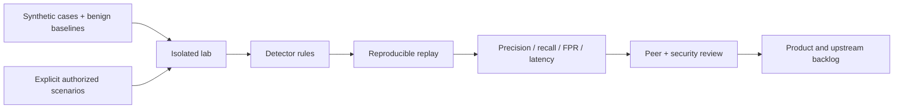

# SCH-10 · Isolated Security Engineering Lab

No uncontrolled network paths, no attacking real external systems, no real malware or personal data in public CI, no collection outside scope. Isolation, containment, reset and egress testing require lab acceptance criteria.
