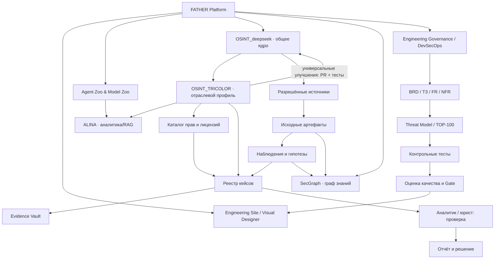
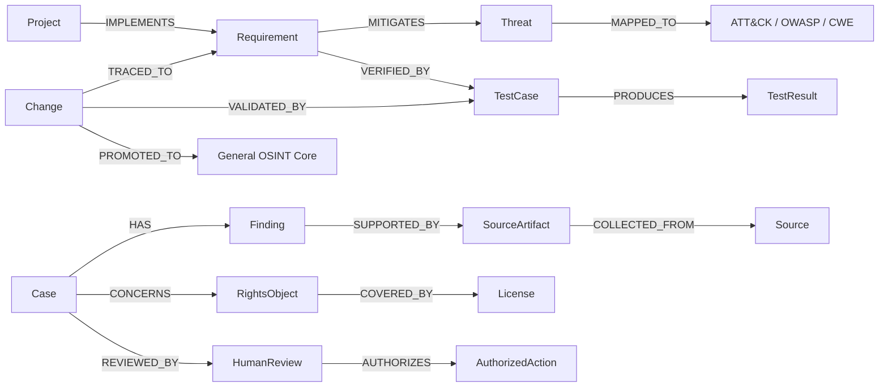

# FATHER · Граф знаний и связей OSINT / TRICOLOR
Версия 0.1 · 2026-10-15 · концептуальная модель, **не реализована**.

## 1. Карта архитектурных и информационных связей

## 2. Семантический граф (типы узлов и рёбер)

## 3. Реестр типов связей
| Relation | Source → target | Meaning |
|---|---|---|
| CONTAINS | Project → Module | принадлежность |
| IMPLEMENTS | Component → Requirement | реализация требования |
| DERIVED_FROM | Requirement → Research | происхождение требования |
| MITIGATES | Control → Threat | мера против угрозы |
| MAPPED_TO | Threat → ATT&CK/CWE/OWASP | методологическая связь |
| VERIFIED_BY | Requirement → TestCase | тест покрытия |
| PRODUCES | TestCase → TestResult | проверяемый результат |
| OBSERVED_IN | Finding → Artifact | подтверждаемое наблюдение |
| COLLECTED_FROM | Artifact → Source | происхождение |
| HAS_HASH | Artifact → IntegrityRecord | контроль целостности |
| CONCERNS | Case → RightsObject | объект кейса |
| COVERED_BY | RightsObject → License | права и исключения |
| REVIEWED_BY | Case → ReviewDecision | экспертная проверка |
| PROPOSES_UPSTREAM | Change → CoreRepository | кандидат переноса |
| PROMOTED_TO | ApprovedChange → CoreRelease | проверенное внедрение |

## 4. Обязательные атрибуты графа
**Node:** node_id, type, label, source_uri, created_utc, status, version, sensitivity, owner, confidence, provenance.  
**Edge:** edge_id, from_id, to_id, relation_type, evidence_refs, confidence, valid_from, valid_to, status, reviewer.

Нужно хранить ориентированность связи, её источник, статус проверки и историю. Связь публичных контактов/доменов **не доказывает** идентичность физического лица. Предположения отделять от фактов. Доступ к ПД и материалам расследований разграничить.

## 5. Пример аналитического пути (синтетические сущности)
SOURCE-001 → ART-001 → FIND-001 → CASE-001 → REVIEW-001 → REPORT-001  
CASE-001 → RIGHTS-001 → LICENSE-001  
REQ-014 → TEST-021 → RESULT-021  
Никаких реальных нарушителей здесь не установлено.

## 6. Использование на сайте
Canvas: выбор узла → соседние связи → фильтр по типу/уверенности/статусу → источники и provenance → документ и версию → связанные тесты → ревью → решение. 
Пользовательские проекции: «бизнес», «техническая архитектура», «угрозы», «расследование», «DevSecOps», «история улучшений».
В первую очередь нужен интерактивный просмотр связей; изменение графа только после RBAC и сохранения истории действий.

## 7. Gate
Это **проект графа на обсуждение**: сначала review сущностей, типов рёбер, privacy, базовых бизнес-кейсов и трассировки, затем ERD/API/схема хранения, расчёты и утверждение. Производственную реализацию отложить до готовности FATHER Site, Agent Zoo и Model Zoo.
