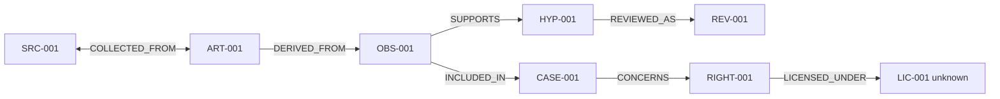

# SC-001 · Synthetic graph case
**Everything in this document is fabricated. It does not allege an infringement by a real person or company.**
## Actors and artifacts
Source SRC-001 = publicly accessible fictional listing on example.test; Artifact ART-001 = lawful snapshot; Observation OBS-001 = text contains illustrative brand name; Hypothesis HYP-001 = possible misleading use; RightsObject RIGHT-001 = placeholder; License LIC-001 = unknown; Case CASE-001; Review REV-001.
## Relations

## Investigation route
Lead entered → approved scope checked → ART-001 source/timestamp stored → OBS-001 separated from interpretation → hypothesis created with low confidence → license status unknown → human review requests additional evidence → no legal action.
## Counterexample
An unrelated domain or IP resembling a protected service does **not** establish illicit activity. Add CONTRADICTS when lawful reseller/license documentation arrives; retain history.
## Acceptance
The graph must show provenances and visibly distinguish observation, hypothesis, expert decision and unknown license.
