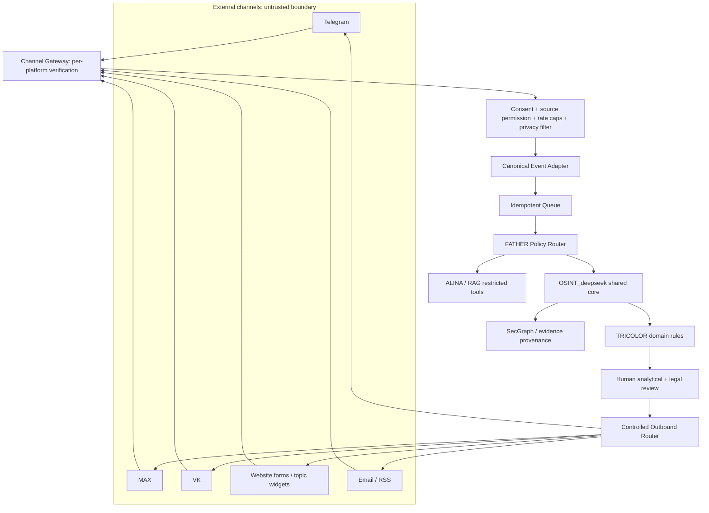

# CHANNEL-002 · Omnichannel architecture

## Data boundary and protections
Provider webhook authentication and replay prevention; independent connector credentials; no untrusted raw content as LLM instructions; storage classification & retention; minimize sender identifiers; per-channel outbound allowlist/opt-in and approvals; schema validation; malware/attachment size control; strict egress. Reject if permission or bot membership is absent.

## Patterns
Inbound: webhook validated → event ID → dedup/idempotency → normalize → provenance → policy routing → draft case.
Outbound: analyst/legal approved template → recipient consent/scope check → channel-specific formatter → send → audit result and retries with backoff.
Topic widgets are presentation components and do not independently fetch sensitive source content from browsers.
