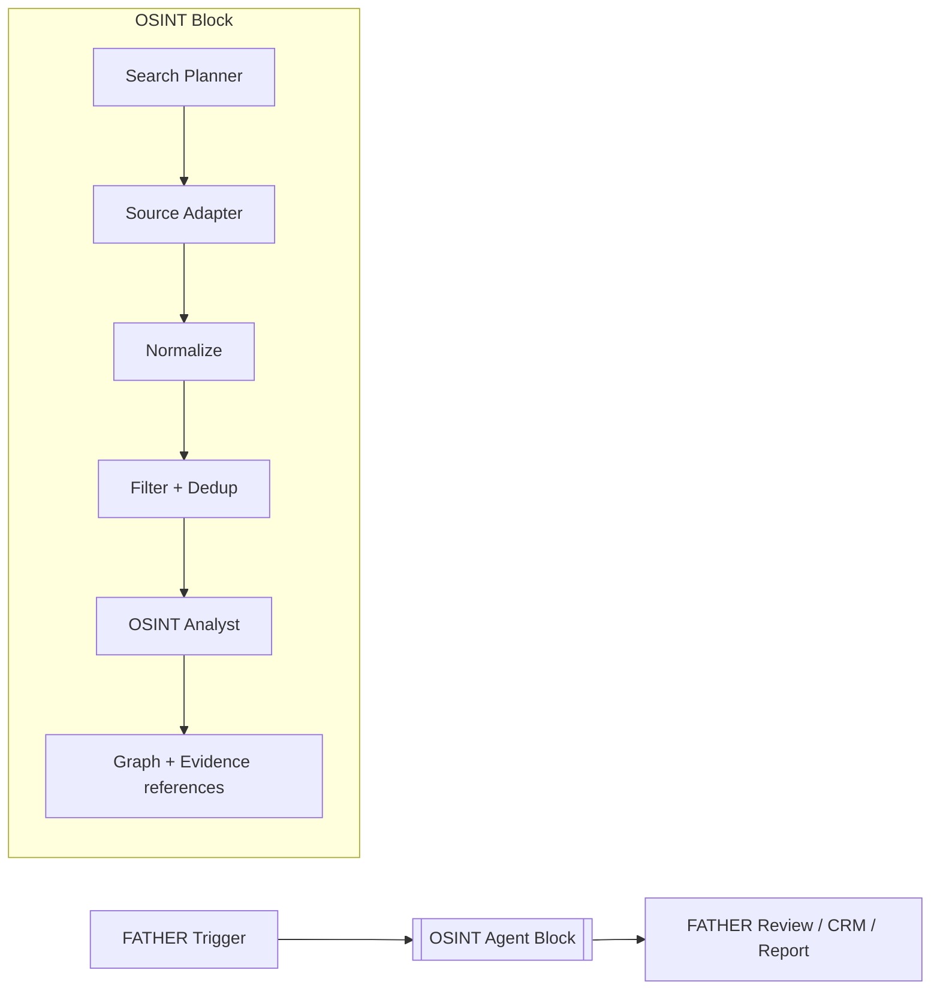

# OSINT BLOCK — FATHER unified canvas integration v0.1
Date: 2026-10-15. Status: DRAFT / implementation ON HOLD.

## Decision
Build **only the OSINT Agent block** within FATHER's single shared visual canvas and design system. Do not build a separate CRM, website, workflow engine, model zoo, memory service, or infrastructure subsystem in this repository.

## Visual placement
The FATHER canvas owns zoom, pan, snapping, node styles, theme, ports, edges, execution log, parameter panel, credentials, policy, and node library. OSINT delivers a reusable expandable composite node with its own nested subgraph.

## Child node palette
OSINT.SearchPlanner; OSINT.Source.Telegram; OSINT.Source.MAX; OSINT.Source.Web; OSINT.Source.RSS; OSINT.Source.ThreatIntel; OSINT.Source.TorApproved; OSINT.Normalize; OSINT.Filter; OSINT.Deduplicate; OSINT.Analyst; OSINT.GraphLink; OSINT.EvidenceRef; OSINT.Export.

Separate provider connectors from query/analysis logic. Tor research is strictly passive and limited to lawful accessible sources or contracted feeds; no bypass of access restrictions.

## Inputs / outputs
Inputs: SearchJob, SourceScope, legal_basis_ref, allowed_source_ids, schedule, policy_context, query_params, resource_budget.
Outputs: CandidateFinding[], Provenance[], EntityLinkProposal[], EvidenceRef[], QualityMetrics, ReviewTask, structured errors.
All outputs are hypotheses until analyst approval. No personal attribution or legal enforcement through the block.

## Uniform node appearance
Use existing FATHER design tokens (not independent CSS): same radius, node header, icon sizing, port layout, statuses, collapsed/expanded presentation, error branch, selection state, hover help, inspector and run logs.
Single common canvas; entering OSINT expands the nested graph, leaving it collapses back into one node. The parent owns run history and evaluation.

## Required contracts
FATHER Agent Zoo (agent selection); Model Zoo (model routing); shared tools & secrets; ALINA (analysis); SecGraph (graph links); common access-control/audit; FATHER workflow execution and budget evaluation.

## Acceptance
1. OSINT block inserts into standard canvas with matching visual tokens.
2. Can switch provider adapter without changing downstream typed edges.
3. Synthetic source event → filter → proposed finding → review output works.
4. Errors, unauthorized access, provider outage, prompt injection and duplicates handled under FATHER security policy.
5. No duplicate implementation of platform shared services.
6. Universally useful OSINT logic goes to OSINT_deepseek upstream with regression tests.

## Governance
Document first, approve UI/architecture/security API and sizing. Preserve existing pause until FATHER Site + Agent Zoo + Model Zoo are practically E2E tested. No production integration now.
