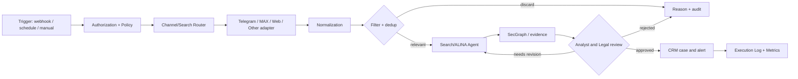

# Visual Workflow / Intelligent Automation design
## Reference capabilities
n8n-style node canvas, branching conditions, error channels, stateful runs, per-node run history, approval steps, resource metrics; not a clone of another service.

## Visual node definition
node_type, api_version, category, typed input/output schema, policy_scope, secret_ref, retry/timeouts, failure_port, idempotency behavior, eval suite, audit tags, cost budget and owner.
Categories: trigger, connector, parser, filter, LLM/VLM, agent, memory, RAG, graph, CRM, approval, notification, exporter, monitoring.
Edges are typed, support success/error/timeout and review branches; publish graph only after static validation, ACL review and runtime test.

## Execution model
DAG validation (explicitly bounded loops if allowed), durable execution IDs, at-least-once delivery with idempotency, dead-letter queue, retries with backoff, rate/cost budgets, trace correlation, redaction and replay from synthetic fixtures. Provider outages must not trigger repeated uncontrolled notifications.
## UI
Node palette; connector credential scopes; visual graph; inspector with inputs, outputs, permissions and cost; execution timeline statuses success/waiting/error/retry; live metrics under privacy constraints; test-mode and approval-mode differences. Mobile/desktop responsiveness and accessible interaction required.

## Gates
Static graph checks, DevSecOps SAST/SCA, source permission, test coverage and security review before publish. Development held pending existing FATHER Site and Zoos E2E acceptance.
