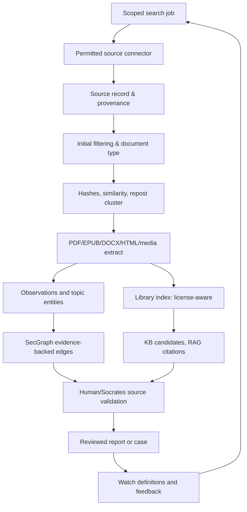

# OSINT Radar — Processing Architecture

Inputs: SearchJob(source allowlist, scope, topic ontology, date range, rate/cost budget, permissions, owner).
Output: ArtifactRef, CandidateKnowledge, ProposedEntityEdge, NewVersion, WatchAlert, CaseRef.
Module status: DESIGNED; map implementation reuse to father_osint/collectors, book_corpus, architecture_book_analyst, acquisition_report, counter_evidence, evidence_quality after contract review.
Pipeline stages: source preflight→fetch permitted data→capture UTC and URL/message IDs→mime/size/rights check→quarantine unsafe attachments→classification→OCR or parsing→dedup/versioning→retrieval index→entity/repost graph→corroboration→analyst approval→controlled alert.
Raw external messages are data, never executable instructions.
