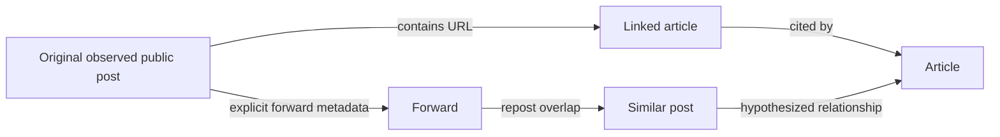

# Source Watchers & Information Propagation
**Status** DRAFT / explicitly non-attribution-first.
## Watcher taxonomy
WATCH-01 keyword and morphological terms; WATCH-02 entity (organization, software, title), WATCH-03 new source/channel, WATCH-04 new document/hash, WATCH-05 updated document or revised edition, WATCH-06 citation of source, WATCH-07 forwarding/repost cluster, WATCH-08 emerging topic anomaly, WATCH-09 negative/contradictory evidence, WATCH-10 IOC/threat advisory update, WATCH-11 missing source/removed page, WATCH-12 licensing/rights change.
Config: watch_id, query, permitted_source_ids, legal_basis, match_rule_version, schedule, threshold, mute_window, expiration, owner, notify_targets, privacy tags.
Debounce, idempotency, false positive review, backfill window and source API limits required.

## Propagation event graph

Distinguish VERIFIED_FORWARD, VERIFIED_LINK, TEXT_SIMILARITY, POSSIBLE_INFLUENCE. Text overlap and chronology do not prove causal influence or identity.
Metrics: first_observed_at (not true first publish), observed repost count, distinct permitted sources, time to next observed mention, citation direction, uncertainty window, missing coverage, cluster confidence. Never label inferred original source as proven original.
Time windows: streaming/backfill, deletion-aware history, revision timeline. Record platform limitation and message permissions per source.

## Analyst view
Timeline of observed mentions, propagation graph, source and copy provenance, cluster diff, conflicting evidence, alert subscription, quality feedback. Avoid person-focused tracking or revealing protected/private memberships.
