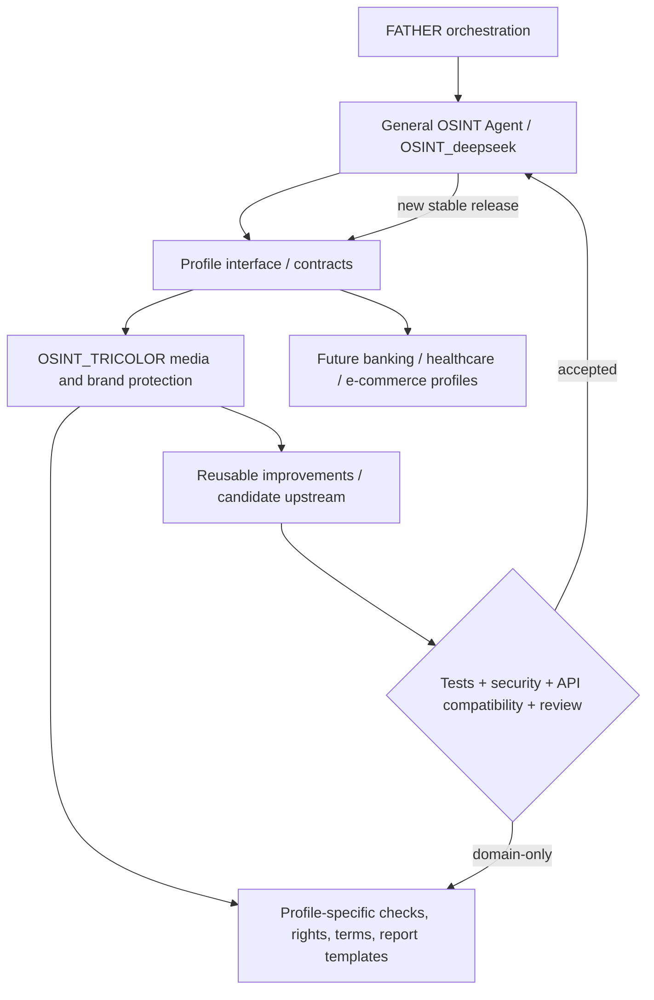

# Architecture · shared core and specialized profiles

## Core design rule: one engine, many configurations

### Responsibilities

**Core:** source adapters, normalized evidence schema, collection policy, provenance, deduplication, entity graph interfaces, risk scoring interfaces, access control, audit, evaluation, report exporters.

**Profile:** media rights, trademark checks, licensing context, broadcasting-specific indicators, case report templates, business priorities.

### Mandatory bidirectional feedback

1. Every improvement developed here is classified **CORE**, **PROFILE**, or **EXPERIMENTAL**.
2. CORE improvements receive a portable implementation and tests without hardcoded Tricolor-specific names.
3. Open an upstream issue / PR in [OSINT_deepseek](https://github.com/VictorKVS/OSINT_deepseek) referencing the source ticket, acceptance criteria, tests and security review. Do not claim automatic upstream integration before merge.
4. Validate contract/API backward compatibility and regressions in the original agent.
5. After approval, release the general agent and update this profile to depend on the shared functionality.
6. PROFILE improvements remain here, and may become configurable adapters if useful across other industries.
7. Record lineage in [UPSTREAM_CANDIDATES.md](UPSTREAM_CANDIDATES.md).

**No duplicated permanent fork.** The industry edition is a product profile and proving ground; it does not become a separate competing OSINT engine.

### Security boundaries

Passive OSINT only by default. Respect access permissions, site terms, legal requirements, minimization of personal data, rate limits, and audit. No credential attacks, access bypass, automated legal accusations, or autonomous enforcement. Human/legal review is mandatory.
